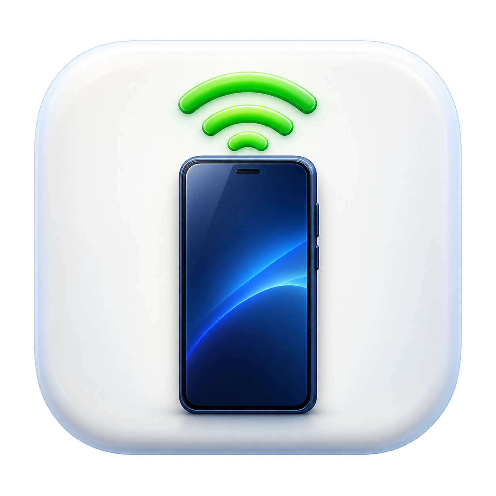

# DroidLink

<p align="center">
  
</p>

DroidLink 是一个原生 macOS 工具，用于发现、配对并连接同一 Wi-Fi 下开启无线调试的 Android 手机。首次配对输入一次六位配对码，之后可以一键重新连接。

## 快速开始

### 使用最新构建

从 [Releases](https://github.com/afetmin/DroidLink/releases/latest) 下载 `DroidLink-macOS-arm64.zip`，解压后打开 `DroidLink.app`：

1. 在手机上开启「开发者选项 → 无线调试」，并让手机与 Mac 连接同一 Wi-Fi。
2. 首次使用时，在手机无线调试页面打开「使用配对码配对设备」并保持窗口打开。
3. DroidLink 会通过 mDNS 自动发现配对地址；在应用中输入手机显示的六位数字，点击「配对并连接」。
4. 配对完成后，日常使用点击「一键连接」即可。发现多台手机时，先在列表中选择目标。

自动发现失败时，可展开「手动地址连接」，分别填写手机配对码窗口和无线调试主页显示的 `IP:端口`。

## 系统要求与本地构建

- macOS 13 或更高版本，仅提供 Apple Silicon（arm64）构建。
- Android 11 或更高版本，手机与 Mac 在同一 Wi-Fi，并已开启无线调试。
- 本机需要已有 `adb`，DroidLink 会检查 `/opt/homebrew/bin`、`/usr/local/bin`、`~/Library/Android/sdk/platform-tools` 以及 `PATH`。
- 应用使用原生 SwiftUI，无第三方包依赖。

在仓库根目录执行：

```bash
xcode-select --install
brew install --cask android-platform-tools
./build.command
```

构建结果为 `dist/DroidLink.app`。也可以从 [Android SDK Platform-Tools 官方页面](https://developer.android.com/tools/releases/platform-tools) 下载 `adb`。

本地构建使用 ad-hoc 签名，未经过 Apple notarization。如果 macOS 阻止打开，请在「系统设置 → 隐私与安全性」中对 DroidLink 选择「仍要打开」，由用户自行确认；无需关闭系统安全功能或批量移除隔离属性。

## 使用说明与故障排查

- 配对码只在当前操作中使用，不会保存或写入操作记录。
- 「修复 ADB」会重启本机共享的 ADB 服务并重新检测；这可能短暂中断其他使用 ADB 的客户端。
- 遇到 `protocol fault` 时，应用会重启 ADB 并自动重试一次；仍失败时，请确认手机状态和 Wi-Fi 后再次检测。
- 找不到手机时，确认手机仍停留在无线调试页面、两台设备处于同一 Wi-Fi，并尝试「重新检测」或手动填写地址。
- 找不到 `adb` 时，请安装 Platform-Tools，或把 `adb` 所在目录加入 `PATH`。
- 设备名称可以在列表中编辑。留空保存即可清除备注；更换 IP 或端口后名称仍会保留。

DroidLink 不上传数据到云端，也不会自动启动。设备名称原子写入：
`~/Library/Application Support/AndroidWireless/device-names.json`。在线设备优先使用硬件序列号作为身份，并保留 mDNS 服务或传输地址作为回退标识。
如果手机不提供硬件序列号，跨地址变化的识别依赖稳定的 mDNS 服务身份；仅有手动地址时，无法保证自动关联到以前的备注。

## 当前验证范围

已验证本地构建、真实设备的 mDNS 配对发现与连接、重复传输去重，以及设备名称的保存、重新打开和清除。应用内完整提交首次配对码的真实端到端流程尚未完成实测；首次配对请按界面提示操作并检查最终连接状态。

## 源码地图

| 路径 | 作用 |
| --- | --- |
| `Sources/ADB.swift` | `adb` 定位、mDNS 服务发现、配对、连接与错误处理 |
| `Sources/App.swift` | SwiftUI 界面、定时检测、一键连接与手动地址入口 |
| `Sources/DeviceNames.swift` | 设备备注、硬件序列号迁移与原子持久化 |
| `build.command` | 生成图标、编译并输出 `dist/DroidLink.app` |
| `Assets/AppIcon.png` | 应用图标源文件 |
